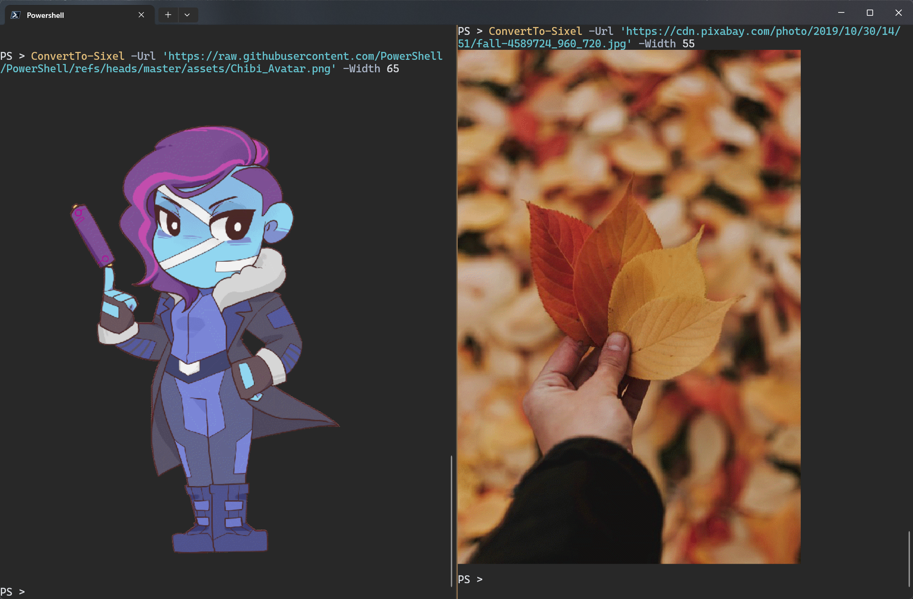
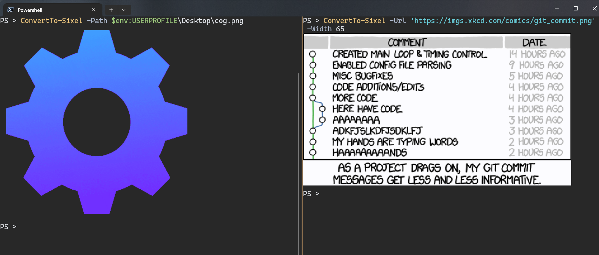

# Sixel

A module that lets you convert images to Sixel, Inline Images Protocol, Kitty Graphics Protocol.  

PowerShell 7 uses ImageSharp for bmp, gif, jpeg, pbm, png, tiff, tga, and webp input.
Windows PowerShell 5.1 uses the built-in System.Drawing/GDI+ codecs for bmp, gif,
jpeg, png, and tiff. Its runtime dependencies are provided by .NET Framework and
Windows PowerShell; no additional dependency DLLs are bundled for Windows PowerShell.

## Install

```powershell
Install-Module Sixel
# or
Install-PSResource Sixel
```

## Requirements

This module supports Powershell version 5.1 & 7.4.  

Both engines support static Sixel, Kitty, and inline images. Windows PowerShell
also supports GIF frames through `ConvertTo-SixelGif` and `ConvertTo-Kitty -Animate`.
Animated inline images and APNG/WebP decoding require PowerShell 7. Resampling and
palette quantization differ between the two image backends, so encoded bytes and
some edge pixels can differ. On .NET Framework, image-taking helper overloads use
System.Drawing types instead of ImageSharp types; cmdlet parameters are unchanged.

Windows Terminal supports Sixel from version 1.22.  

VSCode 1.101+, also requires "Enable Images","Windows Enable Conpty", "Windows Use Conpty Dll" enabled.  

There is an example sixel file in the ./assets folder that can be used for testing  

```powershell
# test sixel
Invoke-RestMethod https://raw.githubusercontent.com/trackd/Sixel/refs/heads/main/assets/chibi.six
```

## Kitty preview

`ConvertTo-Kitty` provides a separate preview of the full Kitty wire protocol,
including native GIF animation (plus APNG/WebP on PowerShell 7), placements, deletion,
composition, and Unicode placeholders. Explicit client APIs provide reply parsing,
disposable local transfers, and cleanup of session-owned images.
The existing `ConvertTo-Sixel` Kitty path remains available for comparison.

```powershell
$image = ConvertTo-Kitty ./assets/cog.png -Width 20 -ImageId 42
[Console]::Write($image)
```

See `Get-Help ConvertTo-Kitty -Full` for parameters and examples.

## Authors

**[@trackd](https://github.com/trackd)**  
**[@ShaunLawrie](https://github.com/ShaunLawrie)**  

## Libraries

- [Sixlabors.Imagesharp](https://github.com/SixLabors/ImageSharp) [Apache2.0](https://github.com/SixLabors/ImageSharp/blob/main/LICENSE)  

## ALC

[PowerShell-ALC](https://github.com/jborean93/PowerShell-ALC)  

## examples

  
  
